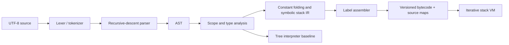

# Architecture and trade-offs

## Pipeline

The tokenizer and lexer are the same lexical pass. Splitting them into two passes would not add useful work for this grammar. Every token, AST node, and instruction keeps a source span.

## Front end

The scanner explicitly recognizes comments, strings, numbers, identifiers, keywords, and longest-match operators. It avoids regex dependencies and preserves locations through Arabic keyword canonicalization. The parser uses recursive descent for declarations/statements and precedence climbing for expressions. This keeps grammar changes local and permits useful “expected X, found Y” diagnostics. The parser reports the first error; it does not attempt multi-error recovery.

The AST uses a shared tagged `Node` structure. This makes JSON inspection straightforward and keeps the implementation small, but lacks the exhaustiveness checking of a class-per-node hierarchy or algebraic data type. A larger language should reconsider that choice.

Semantic analysis first records all function signatures, then checks bodies. A scope stack maps names to types and numbered slots. Unique slots across a function allow inexpensive VM loads/stores while preserving shadowing. Slots are not reused across non-overlapping scopes; this simplifies code generation at the cost of larger frames. Variables are initialized at declaration and there is no uninitialized-declaration form.

Return analysis is deliberately conservative. Only explicit returns and `if/else` with both branches returning guarantee a return. Constant conditions and infinite loops do not eliminate the obligation. This avoids quietly depending on optimizer behavior for language correctness.

## IR, optimization, and assembly

The intermediate representation is a sequence of symbolic stack instructions with named labels. This is a real inspectable representation, but not SSA or three-address code. It is appropriate for a small stack machine and keeps the lowering process visible. `ir` displays labels; `disasm` displays resolved instruction offsets.

The compiler folds pure literal unary/binary expressions and constant short-circuit results after type checking. It does not propagate variables, inline calls, remove branches, or reorder evaluation. Exceptions such as literal division by zero are left as runtime operations so the optimized and unoptimized modes have the same observable error behavior. Non-finite float results are not folded into constants.

Short-circuit lowering retains the left operand with `DUP`, tests a copy with `JZ`/`JNZ`, and either keeps the original value or replaces it with the right operand. This preserves exactly one stack result and skips right-side side effects when required.

The assembler collects label offsets in one pass and resolves branch operands in a second. Source spans pass through unchanged. Constants remain inline in the JSON bytecode rather than living in a deduplicated constant pool; debuggability wins over compactness in this version.

## Virtual machine

Each explicit frame contains a function, instruction pointer, local-slot array, and private operand stack. `CALL` removes arguments from the caller, initializes callee parameter slots, and pushes a new frame. `RET` pops the frame and places a single result (including a void `None` sentinel) on the caller stack. Calls do not recurse through Python, which is tested with 1,500 nested language calls.

| Instruction | Stack effect | Purpose |
| --- | --- | --- |
| `CONST`, `LOAD` | `+1` | Push a literal/local |
| `STORE`, `POP`, `PRINT` | `-1` | Consume top value |
| `DUP` | `+1` | Duplicate top |
| `NEG`, `NOT` | `0` | Unary operation |
| `BINARY` | `-1` | Consume two operands, push one result |
| `JMP` | `0` | Unconditional branch |
| `JZ`, `JNZ` | `-1` | Consume condition and branch |
| `CALL name, n` | `1 - n` | Arguments replaced by return value |
| `RET` | terminal | Return exactly one value |

The dispatch loop counts executed instructions and enforces call-depth limits. A trace hook exposes function, PC, instruction, argument, and operand stack before each step. Runtime arithmetic errors retain their instruction's source position. Diagnostic rendering prints the original source, not reconstructed tokens.

## Artifact verification

The reader checks version, function/frame metadata, spans, allowed opcodes, constants, local indices, branch ranges, and call arity. A worklist analysis checks reachable control flow: stack heights must agree at joins, returns must have exactly one value, and local initialization is intersected across predecessors. Revisiting a join with fewer definitely initialized locals propagates that change to successors.

The verifier is structural, not a replacement for source type checking. It does not prove runtime value types, source/artifact authenticity, memory bounds, or termination. The loader is for trusted compiler artifacts; malformed operand types receive runtime diagnostics where encountered. The VM has no host-operation opcodes, but its execution budgets alone do not make it a sandbox.

## Complexity and boundaries

Scanning is linear in source characters, apart from literal construction/conversion costs. Parsing visits each token with recursion proportional to nesting. Type checking is approximately linear in AST size, with variable lookup proportional to lexical depth. Assembly is linear in instruction count. The simple constant evaluator can revisit nested expressions during emission, so worst-case optimization is quadratic in AST depth; no linear-time optimizer claim is made. The verifier iterates to a fixed point over stack heights and initialization sets.

Runtime cost scales with executed instructions and the cost of primitive operations. Big integers and concatenated strings have operand-dependent costs. Frame memory is proportional to active frames and their local/operand storage. The tree baseline shares parsing, type checking, and primitive arithmetic with the compiler but independently evaluates AST nodes and dictionary-based scopes. Differential tests therefore check lowering/execution consistency; they cannot establish that a shared front-end bug is absent.
